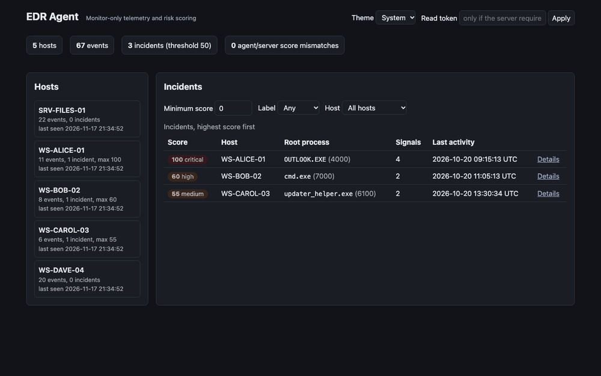
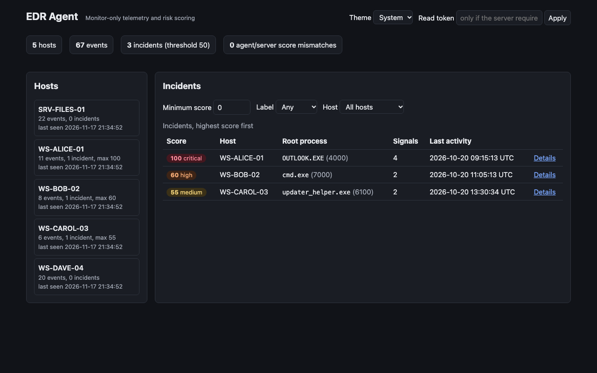
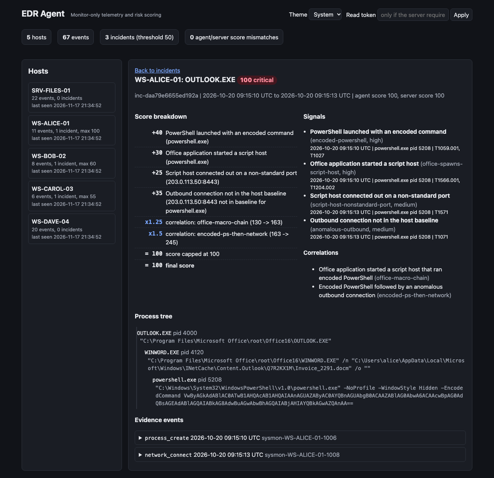
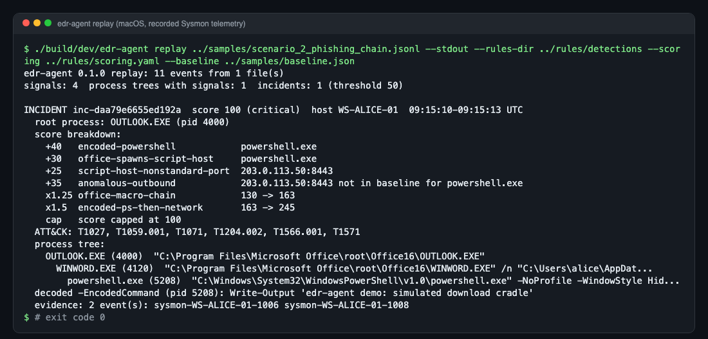

# EDR Agent

**A monitor-only endpoint detection and response (EDR) system: a C++ agent watches Windows process, file, registry and network activity, and a scoring engine flags attack chains instead of single noisy alerts.**
It solves alert fatigue: "PowerShell ran an encoded command" is common and mostly harmless, but *Office → encoded PowerShell → connection to a never-seen IP* on one process tree is an attack, and EDR Agent scores that combination and shows exactly why.

[](https://github.com/arjunpotluri7-spec/edr-agent/actions/workflows/ci.yml)



*Real screens from this repo running on a Mac: the agent replayed the synthetic Sysmon recordings in `samples/`, the forwarder sent them to the FastAPI server, and the React dashboard shows the result. No real hosts were monitored.*

**Tech stack:** C++20 (CMake, GoogleTest, Windows Sysmon + ETW APIs) · Python 3.11+ (FastAPI, SQLAlchemy, Alembic) · PostgreSQL · React + TypeScript (Vite) · Docker Compose · GitHub Actions (Linux, macOS and Windows/MSVC builds)

**Highlights**
- Multi-signal risk scoring per process tree with correlation rules (e.g. encoded PowerShell + anomalous outbound connection = critical), every point explained
- The same scoring engine in C++ (agent) and Python (server); a test proves both give byte-identical results
- 90 agent tests, 85 server tests and 9 dashboard tests, plus sanitizer builds, all run in CI

**Run it locally (macOS/Linux, no Windows needed):**

```bash
cd agent && cmake --preset dev && cmake --build --preset dev
./build/dev/edr-agent replay ../samples/scenario_2_phishing_chain.jsonl --stdout \
    --rules-dir ../rules/detections --scoring ../rules/scoring.yaml --baseline ../samples/baseline.json
```

Full stack with Docker: `docker compose up --build` (dashboard on http://127.0.0.1:8080). Step-by-step setup is in [Build & install](#build--install).

| Incident list | Incident detail | Agent output |
|---|---|---|
|  |  |  |

> **Scope.** EDR Agent only observes telemetry that Windows already produces and reports it.
> It never blocks, kills, quarantines, hooks or injects into processes, never hides or persists
> itself, and never changes system, Sysmon or ETW configuration. Use it only on hosts you own
> or are authorized to monitor. See [Ethics and scope](#ethics-and-scope).

## Why this exists

Single-rule alerting drowns analysts: "PowerShell ran with `-EncodedCommand`" or "a program
connected to a new IP" are each common and mostly benign. What matters is the *combination* on
the same process tree within a few minutes: Office starting a script host, which runs an
encoded command, which then talks to an address the host has never used. EDR Agent is built
around that idea, and keeps every scoring step visible so an analyst can check the reasoning
instead of trusting a number.

## Distinctive feature: transparent multi-signal scoring, computed twice

- **Signals, not alerts.** Every rule match is a weighted signal (`+40 encoded-powershell`),
  grouped by process tree (`OUTLOOK.EXE -> WINWORD.EXE -> powershell.exe`) inside a 10-minute
  context window.
- **Correlations escalate known-bad combinations.** "Encoded PowerShell, then an anomalous
  outbound connection from the same tree" multiplies the score by 1.5 and raises it to at least
  60. "Anomalous" means the (image, destination) pair is not in the host's learned baseline, or
  the destination is in a configured untrusted range.
- **Noise stays quiet by construction.** Repeats of the same rule decay (10, 5, 2, 0), all
  low-severity signals in a tree are capped at 20 points, and an incident needs a score of at
  least 50 *and* at least two different kinds of signal (one critical signal is exempt). The
  noise sample fires 13 rules and produces no incident.
- **Every step is shown.** Incidents carry the full breakdown (`+40`, `+35`, `x1.5 (75 -> 113)`,
  `cap 100`), the process-tree excerpt and the evidence events, in the CLI and the dashboard.
- **Two independent implementations, byte-identical.** The same algorithm runs in C++ on the
  endpoint and in Python on the server, with integer-only arithmetic. The server re-scores the
  raw telemetry it receives and flags any disagreement with the agent (stale rules, lost events
  or a tampered report). A test runs both on every sample and requires identical JSON output.

## Features

- **Collectors** behind one `ICollector` interface:
  - `SysmonCollector` (Windows): `EvtSubscribe` on `Microsoft-Windows-Sysmon/Operational`,
    `EvtRender` to XML, mapped from event IDs 1, 3, 5, 7, 10, 11, 12, 13, 14, 22, 23 and 26.
  - `EtwCollector` (Windows, Administrator): a real-time session
    (`StartTrace` / `EnableTraceEx2` / `OpenTrace` / `ProcessTrace`) on
    Microsoft-Windows-Kernel-Process, -Kernel-Network and -DNS-Client, decoded with TDH.
  - `ReplayCollector` (all platforms): recorded JSON-lines events with optional time scaling.
    **This is how the agent is tested on macOS and Linux.**
- **Portable parsing.** The Sysmon XML-to-event mapping and the ETW property mapping are plain
  C++ with no Windows dependency, so they are unit-tested on every OS against synthetic Sysmon
  XML fixtures. `edr-agent parse-sysmon` converts exported Sysmon XML into replayable events.
- **13 behavioral rules** in YAML (encoded PowerShell with real Base64/UTF-16LE decoding,
  Office spawning a script host, LOLBins on the network, Run-key and Startup-folder
  persistence, service creation, LSASS access, shadow-copy deletion, high-entropy DNS,
  non-standard ports, Temp-folder execution, discovery commands, scheduled tasks) plus the
  built-in anomalous-outbound signal and 4 correlations.
- **Server**: authenticated, size- and rate-limited, idempotent ingest; PostgreSQL via
  SQLAlchemy 2 + Alembic (SQLite for tests); server-side re-scoring; read API for hosts,
  incidents, incident detail and stats.
- **Dashboard**: hosts, incidents sorted by score, incident detail with the score breakdown,
  process tree and evidence, filters, light/dark themes, keyboard- and screen-reader-friendly.
- **Output**: batched JSON to the server over HTTPS (WinHTTP on Windows; a `0600` spool file plus
  a Python forwarder elsewhere), or `--stdout` for demos. Structured text/JSON logs.

## Architecture

```
 Windows endpoint                                         Server (127.0.0.1 by default)
 ┌──────────────────────────────────────────────┐        ┌─────────────────────────────────┐
 │ Sysmon event log ──► SysmonCollector ─┐       │        │ FastAPI  POST /api/v1/events     │
 │ ETW providers ─────► EtwCollector ────┤ queue │ HTTPS  │          POST /api/v1/incidents  │
 │ JSONL recording ──► ReplayCollector ──┘   │   │ ─────► │  token auth, limits, validation  │
 │                                            ▼   │ batch  │          │                       │
 │   enrich (process table, parent, decoded       │        │          ▼                       │
 │   -EncodedCommand) ─► rules (YAML) ─► signals  │        │  same engine in Python:          │
 │   ─► per-tree scorer + correlations ─► incidents       │  re-score, compare, store        │
 │   ─► BatchingOutput (WinHTTP | spool | stdout) │        │          │                       │
 └──────────────────────────────────────────────┘        │          ▼                       │
                                                          │     PostgreSQL ◄── GET /api/v1/* │
                                                          └──────────────────────────▲──────┘
                                                                                     │
                                                       React dashboard (nginx, read-only)
```

| Component | Main files |
|---|---|
| Event model | `agent/include/edr/event.hpp`, `src/engine/event.cpp` |
| Collectors | `src/collectors/replay_collector.cpp`, `sysmon_mapping.cpp`, `etw_mapping.cpp`, `src/windows/sysmon_collector.cpp`, `etw_collector.cpp` |
| Rules and conditions | `src/engine/rules.cpp`, `condition.cpp`, `encoded_command.cpp`, `netutil.cpp` |
| Scorer | `src/engine/scorer.cpp` (mirrored by `server/src/edr_server/engine/scorer.py`) |
| Parsers (no third-party libs) | `src/core/json.cpp`, `yaml.cpp` (documented subset), `xml.cpp` (no DTD/XXE) |
| Output | `src/output/output.cpp` (batching, spool), `src/windows/winhttp_transport.cpp` |
| Server | `server/src/edr_server/app.py`, `rescoring.py`, `security.py`, `db.py`, `migrations/` |
| Dashboard | `dashboard/src/App.tsx`, `components/` |

## What runs where

| Where | What works | Notes |
|---|---|---|
| **macOS / Linux** | Replay of recorded events, all agent unit tests (Sysmon XML parsing, ETW mapping, rules, scoring, replay end-to-end), the server, the dashboard | `edr-agent run` exits with a clear message: live collection needs Windows |
| **Windows** | Live Sysmon and ETW collection with `edr-agent run`, WinHTTP output | Needs Sysmon installed and configured by you, and Administrator (ETW, and reading the Sysmon channel unless you are in Event Log Readers) |
| **CI (GitHub Actions)** | Linux + macOS builds and tests, ASan/UBSan, the Windows MSVC build with the Sysmon/ETW collectors and its unit tests, clang-format/clang-tidy, server on SQLite and PostgreSQL, dashboard, `docker compose build` + a smoke test | The Windows collectors are compiled and unit-tested there but are **not** exercised against a live event stream in CI |

## Build & install

### Agent (C++20)

Requirements: a C++20 compiler (Apple clang 21 locally; clang on GitHub's Linux/macOS runners;
MSVC on Windows), Ninja and CMake 3.25+. The CI-pinned CMake, clang-format and clang-tidy go in
a repo-local venv:

```bash
python3 -m venv .tools && .tools/bin/pip install -r agent/tools/requirements.txt
export PATH="$PWD/.tools/bin:$PATH"

cd agent
cmake --preset dev            # Debug, warnings as errors (also: asan, release)
cmake --build --preset dev
ctest --preset dev
./build/dev/edr-agent --version
```

On Windows, from a "Developer PowerShell for VS" prompt (or after `ilammy/msvc-dev-cmd` in CI):

```powershell
cd agent
cmake --preset windows-msvc   # Ninja + cl, -DEDR_ENABLE_WINDOWS_COLLECTORS=ON
cmake --build --preset windows-msvc
ctest --preset windows-msvc
```

### Installing Sysmon (your responsibility)

EDR Agent does not install or configure Sysmon. Follow Microsoft's documentation:
https://learn.microsoft.com/sysinternals/downloads/sysmon

Your Sysmon configuration must log the event IDs the agent maps (1, 3, 5, 10, 11, 12, 13, 14, 22,
and optionally 7, 23/26); Sysmon's defaults do not include all of them. Review any configuration
for the volume it produces on your hosts.

### Server (Python 3.11+)

```bash
cd server
python3 -m venv .venv && .venv/bin/pip install -r requirements-dev.txt
.venv/bin/pytest -q
```

### Dashboard

```bash
cd dashboard && npm ci && npm run build      # npm run dev proxies /api to 127.0.0.1:8000
```

## Quick start against `samples/`

Everything in `samples/` is synthetic (see [samples/README.md](samples/README.md)).

```bash
cd agent
./build/dev/edr-agent rules check --rules-dir ../rules/detections --scoring ../rules/scoring.yaml
./build/dev/edr-agent replay ../samples/scenario_2_phishing_chain.jsonl --stdout \
    --rules-dir ../rules/detections --scoring ../rules/scoring.yaml --baseline ../samples/baseline.json
./build/dev/edr-agent parse-sysmon ../samples/sysmon_xml/scenario_3_runkey_persistence.xml
```

End to end with the server and dashboard on one machine (no Docker):

```bash
TOKEN=$(python3 -c "import secrets; print(secrets.token_urlsafe(32))")
HASH=$(printf '%s' "$TOKEN" | PYTHONPATH=server/src server/.venv/bin/python -m edr_server hash-token)
EDR_AGENT_TOKEN_HASHES="ws-alice-01:$HASH" EDR_BASELINE_FILE=samples/baseline.json \
  PYTHONPATH=server/src server/.venv/bin/python -m edr_server serve      # 127.0.0.1:8000

# agent writes a spool (agent.example.yaml uses output.mode: spool), the forwarder posts it
cp agent/agent.example.yaml agent/agent.yaml
./agent/build/dev/edr-agent replay samples/scenario_2_phishing_chain.jsonl --config agent/agent.yaml \
    --baseline samples/baseline.json
EDR_AGENT_TOKEN="$TOKEN" PYTHONPATH=server/src server/.venv/bin/python -m edr_server.forwarder \
  --spool agent/edr-agent-spool.jsonl --server-url http://127.0.0.1:8000 --agent-id ws-alice-01

(cd dashboard && npm run dev)                                            # http://127.0.0.1:5173
```

## Usage

```
edr-agent run --config agent.yaml            live Sysmon/ETW collection (Windows, admin)
edr-agent replay FILE.jsonl... [options]     replay recorded events (any OS)
edr-agent rules check [--rules-dir D] [--scoring F]
edr-agent rules dump  [--rules-dir D] [--scoring F]   parsed YAML as JSON (for tests)
edr-agent parse-sysmon FILE.xml [--host NAME]  convert exported Sysmon XML to JSON lines
edr-agent --version | --help

replay options:
  --stdout              print results instead of sending them (demo mode)
  --format text|jsonl   stdout format (default text)
  --speed N             replay N times faster than recorded (default: as fast as possible)
  --config agent.yaml   take rules, baseline and output settings from an agent config
  --rules-dir D         detection rules directory (default rules/detections)
  --scoring F           scoring config (default rules/scoring.yaml)
  --baseline F          baseline JSON of known (host, image, destination) pairs
  --fail-on-incident    exit 1 if any incident was raised

global options: --log-level error|warn|info|debug (default warn), --log-format text|json
exit codes: 0 ok, 1 incidents (with --fail-on-incident), 2 usage or config error,
            3 input error, 4 output error
```

Exported Sysmon logs (`wevtutil qe Microsoft-Windows-Sysmon/Operational /f:xml`) can be turned
into replay files with `parse-sysmon` and analyzed on any OS.

## Configuration

[`agent/agent.example.yaml`](agent/agent.example.yaml) (annotated) sets the agent id, rules,
optional baseline, collectors (Sysmon on, ETW off by default), the bounded event queue, output
(`stdout`, `spool` or `http`; batching and flush interval) and logging. Relative paths resolve
against the config file. **The enrollment token is never in the file**: `output.token_env`
names the environment variable that holds it. `server_url` must be `https://`, except
`http://` for `127.0.0.1` / `localhost` / `[::1]`; certificate validation cannot be turned off.

Server settings are environment variables (see [`.env.example`](.env.example)):
`DATABASE_URL`, `EDR_AGENT_TOKEN_HASHES` (`agent-id:sha256-of-token,...`; only hashes are
configured), optional `EDR_READ_TOKEN_HASH`, `EDR_BASELINE_FILE`, `EDR_RULES_DIR`,
`EDR_SCORING_FILE`, `EDR_MAX_BODY_BYTES` (2 MiB), `EDR_MAX_BATCH_ITEMS` (1000),
`EDR_RATE_LIMIT_PER_MINUTE` (120), `EDR_LOG_LEVEL`, `EDR_LOG_FORMAT`.

Rules and scoring: [docs/rules.md](docs/rules.md) and [docs/scoring.md](docs/scoring.md).

## Sample output (real)

`edr-agent replay samples/scenario_2_phishing_chain.jsonl --stdout --baseline samples/baseline.json`
(rules and scoring flags omitted for width):

```
edr-agent 0.1.0 replay: 11 events from 1 file(s)
signals: 4  process trees with signals: 1  incidents: 1 (threshold 50)

INCIDENT inc-daa79e6655ed192a  score 100 (critical)  host WS-ALICE-01  09:15:10-09:15:13 UTC
  root process: OUTLOOK.EXE (pid 4000)
  score breakdown:
    +40   encoded-powershell            powershell.exe
    +30   office-spawns-script-host     powershell.exe
    +25   script-host-nonstandard-port  203.0.113.50:8443
    +35   anomalous-outbound            203.0.113.50:8443 not in baseline for powershell.exe
    x1.25 office-macro-chain            130 -> 163
    x1.5  encoded-ps-then-network       163 -> 245
    cap   score capped at 100
  ATT&CK: T1027, T1059.001, T1071, T1204.002, T1566.001, T1571
  process tree:
    OUTLOOK.EXE (4000)  "C:\Program Files\Microsoft Office\root\Office16\OUTLOOK.EXE"
      WINWORD.EXE (4120)  "C:\Program Files\Microsoft Office\root\Office16\WINWORD.EXE" /n "C:\Users\alice\AppDat...
        powershell.exe (5208)  "C:\Windows\System32\WindowsPowerShell\v1.0\powershell.exe" -NoProfile -WindowStyle Hid...
  decoded -EncodedCommand (pid 5208): Write-Output 'edr-agent demo: simulated download cradle'
  evidence: 2 event(s): sysmon-WS-ALICE-01-1006 sysmon-WS-ALICE-01-1008
```

Run-key persistence without network (scenario 3):

```
INCIDENT inc-dbd075e98e6adce6  score 55 (medium)  host WS-CAROL-03  13:30:30-13:30:34 UTC
  root process: updater_helper.exe (pid 6100)
  score breakdown:
    +10   exec-from-user-temp           updater_helper.exe
    +30   run-key-persistence           HKU\S-1-5-21-1111111111-2222222222-3333333333-1103\Software\Microsoft\Windows\CurrentVersion\Run\UpdaterHelper
    +15   temp-binary-persistence       correlation bonus -> 55
```

LOLBin download (scenario 4):

```
INCIDENT inc-6c74008a22c6ff09  score 60 (high)  host WS-BOB-02  11:05:13-11:05:13 UTC
  root process: cmd.exe (pid 7000)
  score breakdown:
    +25   lolbin-network                192.0.2.80:80
    +35   anomalous-outbound            192.0.2.80:80 is in untrusted range 192.0.2.0/24
```

Thirteen low-severity hits that do **not** become an incident (scenario 5):

```
edr-agent 0.1.0 replay: 20 events from 1 file(s)
signals: 13  process trees with signals: 4  incidents: 0 (threshold 50)

below the incident threshold (signals only):
  WS-DAVE-04    cmd.exe (8000)                score 17  (low)      5 signal(s)
  WS-DAVE-04    chrome.exe (8100)             score 17  (low)      4 signal(s)
  WS-DAVE-04    setup_bootstrap.exe (8200)    score 20  (low)      2 signal(s)
  WS-DAVE-04    cmd.exe (8300)                score 15  (low)      2 signal(s)
```

The benign admin day (scenario 1, 22 events) prints `no signals: nothing matched the loaded
rules`.

## How the score is computed

Short version (details and more examples in [docs/scoring.md](docs/scoring.md)):

1. Each rule match is a signal worth the rule's points (severity default: low 10, medium 25,
   high 40, critical 60); anomalous outbound is worth 35.
2. Signals are grouped by process tree (walk up the parents until a shell/service host such as
   `explorer.exe`) and only count for 10 minutes of event time.
3. Repeats of the same rule decay by half and stop after three; low-severity signals are capped
   at 20 points per tree.
4. Correlations, in order: `score = (score * multiplier_percent + 50) // 100`, then `+ bonus`,
   then raise to `min_score`; finally cap at 100.
5. Incident when the score is at least 50 **and** the tree has at least two different signal
   types (or a critical one). Labels: low < 30 <= medium < 60 <= high < 80 <= critical.

**Worked example (the resume case): encoded PowerShell + anomalous outbound.**

| Step | Points | Score |
|---|---|---|
| `encoded-powershell` (Base64 payload decoded) | +40 | 40 |
| `anomalous-outbound` (203.0.113.50:443 not in baseline for powershell.exe) | +35 | 75 |
| `encoded-ps-then-network` correlation | x1.5 | (75 x 150 + 50) // 100 = 113 |
| cap | | **100, critical** |

Alone, the encoded command scores 40 (medium, no incident); the same two signals without the
correlation score 75 (high). These three cases are unit tests in both engines.

## Server API

| Method and path | Auth | Purpose |
|---|---|---|
| `POST /api/v1/events` | agent | `{"agent_id", "host", "events": [...]}`; idempotent by event id; triggers re-scoring of the host |
| `POST /api/v1/incidents` | agent | `{"agent_id", "host", "incidents": [...]}`; a version is stored only if newer |
| `GET /api/v1/hosts` | read | hosts with event counts, incident counts and max score |
| `GET /api/v1/incidents?min_score=&host=&label=&limit=&offset=` | read | sorted by score |
| `GET /api/v1/incidents/{id}` | read | signals, breakdown, process tree, evidence, agent vs server detail |
| `GET /api/v1/stats` | read | totals, incidents by label, agent/server score mismatches |
| `GET /healthz` | none | liveness and database check |

Agent auth: `Authorization: Bearer <token>` and `X-Agent-Id: <id>`; missing or wrong
credentials get 401, a body `agent_id` that differs from the credentials gets 403, oversized
bodies 413, invalid payloads 422, too many requests 429. "read" endpoints are open on the
loopback interface unless `EDR_READ_TOKEN_HASH` is set.

## Docker

`docker-compose.yml` runs PostgreSQL (`postgres:17.10-alpine`), the server (`python:3.12.14-slim-bookworm`,
non-root user, read-only filesystem, health check) and the dashboard (built with `node:22.23.2-alpine`,
served by `nginxinc/nginx-unprivileged:1.30.4-alpine`, which proxies only the read API). All
ports are published on `127.0.0.1`.

```bash
cp .env.example .env        # then put real values in .env
docker compose up -d --build
open http://127.0.0.1:8080
```

For agents on other machines, put a TLS-terminating reverse proxy in front of the server;
the agent refuses plain HTTP to anything but localhost.

**Docker was not run on the development machine** (it is not installed there). The compose file
was validated as YAML locally, and CI runs `docker compose build`, `docker compose up --wait` and
[`scripts/compose_smoke.py`](scripts/compose_smoke.py) (health check, ingest of every sample via
the forwarder, read API through nginx). The same smoke script was run locally against a plain
`uvicorn` server with SQLite.

## Testing

| Suite | Command | Result on the development machine (macOS, Apple clang 21, Python 3.14.5, Node 26) |
|---|---|---|
| Agent, dev preset | `ctest --preset dev` | `100% tests passed out of 90` |
| Agent, ASan + UBSan | `ctest --preset asan` | `100% tests passed out of 90` |
| Agent lint | `agent/tools/lint.sh` | `clang-format: ok`, `clang-tidy: ok` |
| Server | `ruff check . && ruff format --check . && pytest -q` | `All checks passed!`, `28 files already formatted`, `85 passed` |
| Dashboard | `npm run lint && npm test && npm run build` | ESLint clean, `Tests 9 passed (9)`, `built` |

What the tests cover:

- **Sysmon XML parsing on every OS**: the five scenario XML files must map to exactly the events
  in the replay files; hand-written fixtures cover IDs 7, 10, 12, 14, 23, 26, entities, an
  unsupported ID, a record without a process id, and a DOCTYPE/XXE attempt (rejected).
- **ETW mapping**: process start with device-path conversion, TCPv4/v6 with network byte order,
  DNS-Client 3008, ignored IDs.
- **Every rule** has positive and negative cases in `samples/rule_cases.jsonl`, run by both the
  C++ and the Python suites.
- **Encoded commands**: the demo payload, every flag prefix, quotes, missing padding, surrogate
  pairs, invalid Base64, odd byte counts, NUL, lone surrogates, oversize payloads.
- **Scoring**: single hit stays low, combination is critical, same-tree requirement, boundary
  images, window expiry (11 minutes vs 9:59), ordering, baseline / trusted / untrusted / learning,
  repeat decay, low-severity cap, bonus and floor correlations, multi-signal requirement,
  critical-alone, incident versioning.
- **Replay end to end** over each scenario, plus invalid lines, missing files and `--speed`.
- **Config validation** (agent YAML, server URLs, token from environment only), spool file
  permissions and symlink refusal, batching, structured logs, CLI exit codes.
- **Server**: 401 for missing/bad/foreign tokens, 403 for agent-id mismatch, 422 validation,
  idempotent events, monotonic incident versions, 413 (including chunked bodies), 429, queries,
  re-scoring parity, tampered agent scores flagged, server-only detections, optional read token,
  Alembic migration, forwarder resume.
- **Parity**: `server/tests/test_parity.py` runs `edr-agent replay --format jsonl` and requires
  the same JSON as the Python engine for each scenario and for all of them in one run, and
  checks that the C++ YAML subset reads every rule file exactly like PyYAML. It is skipped with
  a clear message if the agent has not been built.

## Limitations

- **Windows collectors are not verified on a live host by this project.** The Sysmon and ETW
  collectors and the WinHTTP transport are built with MSVC and unit-tested in CI, and on the
  development machine they were only compiled against MinGW Windows SDK headers (syntax and
  types, no linking). Their XML/property mapping is tested everywhere; the event-delivery code
  paths (`EvtSubscribe`, `ProcessTrace`, WinHTTP) have not been run against real events.
- **ETW details from manifests.** Event IDs and property names come from the provider manifests
  (Windows 10 1803). Kernel-Network ports and IPv4 addresses are assumed to be in network byte
  order; this is how the provider is commonly described but it was not observed here.
  Kernel-Process does not include command lines, and DNS-Client events carry only a process id.
- **Running Sysmon and ETW together duplicates process events**; the default config enables
  only Sysmon. There is no cross-source de-duplication.
- **No bookmarks**: the Sysmon subscription starts at future events; anything logged while the
  agent is stopped is not collected.
- **Baseline matters.** Without a baseline, first-seen destinations add anomalous-outbound
  signals (the noise sample then yields two medium incidents). Learning is in memory per process;
  there is no baseline persistence yet.
- **PID reuse and process GUIDs.** Trees are built from PIDs within the window; Sysmon process
  GUIDs are carried but not used for linking.
- **Server re-scoring is simple**: it re-runs the engine over a host's most recent 20,000
  events on each ingest batch. Fine for a lab, not for a fleet.
- **Regex subset.** Rules must stay within the common subset of ECMAScript and Python regex;
  `std::regex` is also slow on long inputs (subjects are capped at 4 KiB).
- **No TLS in the server itself**; terminate TLS in front of it for remote agents.
- **Rate limiting is in memory** per server process.

## Roadmap

- Sysmon bookmarks and ETW/Sysmon de-duplication by process GUID
- Persisted, signed baselines with a learning period per host
- More correlations (credential access followed by lateral movement, defense evasion chains)
- Sigma rule import for the single-event part of rules
- Windows service wrapper with event-log logging

## Ethics and scope

EDR Agent is a defensive monitoring and detection tool for learning, detection engineering and
authorized security operations.

- **Monitor-only.** It reads telemetry Windows already produces. It has no capability to
  block, kill, quarantine, hook, inject, hide, persist or reconfigure anything, and changes
  that add such capabilities are out of scope for the project.
- **Authorized hosts only.** Deploy it only on systems you own or have written permission to
  monitor, and follow your organization's privacy rules: process command lines, user names and
  network destinations are personal data in many jurisdictions.
- **Synthetic data only** in this repository: no real hosts, users, addresses or malware.

## License

[MIT](LICENSE). Copyright (c) 2026 EDR Agent contributors.
